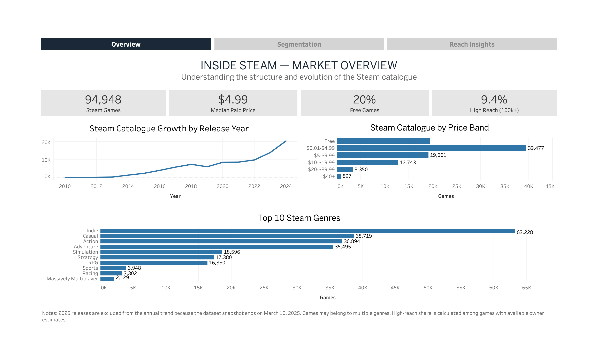
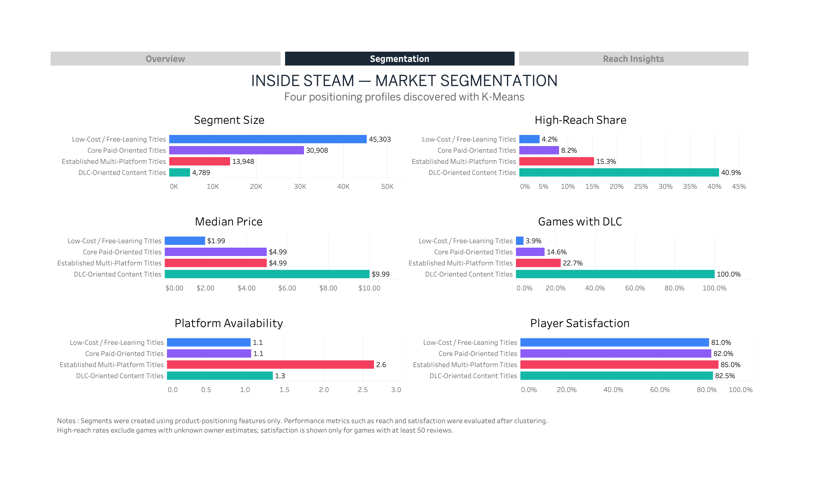
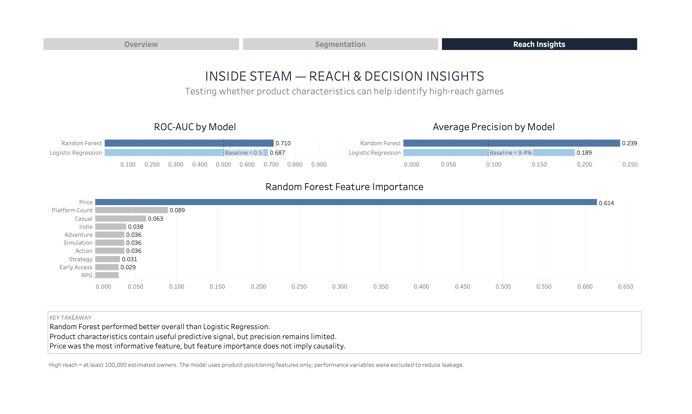

# Inside Steam: Market Performance & Player Engagement

Market and product analytics on **94,948 Steam games**, combining Python, PostgreSQL, statistical analysis, machine learning and Tableau to explore how pricing, product positioning and game characteristics relate to player reach, engagement and satisfaction.

## Interactive Dashboard

Explore the full interactive dashboard on **Tableau Public**:

[View the interactive Tableau dashboard](https://public.tableau.com/views/Inside_Steam_Dashboardcopie/01MarketOverview?:language=fr-FR&:sid=&:redirect=auth&:display_count=n&:origin=viz_share_link)

### Market Overview



### Market Segmentation



### Reach & Decision Insights



---

## Project Objective

The project investigates the following question:

> **How do game characteristics, pricing and market positioning relate to player reach, engagement and satisfaction on Steam?**

The analysis follows four main stages:

**Understand → Segment → Predict → Decision Support**

The objective is not to build a definitive predictor of commercial success, but to create an exploratory decision-support framework for understanding different positioning strategies in the Steam market.

---

## Dataset

The main dataset is the **Steam Games Dataset 2025**, containing:

- **94,948 games**
- Steam catalogue data through **March 10, 2025**
- Pricing and release information
- Genres and platform availability
- Estimated owner ranges
- Review and satisfaction metrics
- Playtime and peak concurrent player information
- Achievements and DLC information

Estimated owners are provided as broad ranges and should not be interpreted as exact sales figures.

The project also includes a smaller current-data enrichment sample using Steam web/API data to compare the historical dataset with more recent releases.

---

## Analysis Workflow

### 1. Data Audit & Cleaning

The raw dataset was audited and transformed into an analysis-ready dataset using Python and pandas.

Main steps included:

- data type validation
- missing-value analysis
- duplicate checks
- feature engineering
- review coverage indicators
- estimated owner range parsing
- pricing and reach categories
- reusable cleaned dataset export

---

### 2. SQL Analysis

The cleaned data was loaded into **PostgreSQL** and analysed through reusable analytical queries and views.

SQL was used to investigate:

- market structure
- pricing patterns
- player reach
- satisfaction
- engagement
- product characteristics

The SQL workflow includes joins, CTEs, aggregations and window functions.

---

### 3. Statistical Analysis

Statistical testing was used to validate patterns observed during exploratory analysis.

Key results included:

- Satisfaction differs statistically across price bands, but the effect size is very small.
- Player satisfaction shows no meaningful monotonic relationship with estimated reach.
- Playtime and satisfaction show only a very weak positive relationship.
- Price band and high-reach status show a moderate association, but this should not be interpreted as causal.

---

## Market Segmentation

K-Means clustering was used to identify recurring **product-positioning profiles** in the Steam catalogue.

Performance variables such as reach and satisfaction were deliberately excluded from the clustering process and evaluated only afterwards.

Four interpretable segments emerged:

| Segment | Games | Median Price | High-Reach Share | Median Satisfaction* |
|---|---:|---:|---:|---:|
| Low-Cost / Free-Leaning Titles | 45,303 | $1.99 | 4.2% | 81.0% |
| Core Paid-Oriented Titles | 30,908 | $4.99 | 8.2% | 82.0% |
| Established Multi-Platform Titles | 13,948 | $4.99 | 15.3% | 85.0% |
| DLC-Oriented Content Titles | 4,789 | $9.99 | 40.9% | 82.5% |

\* Satisfaction is evaluated only for games with at least 50 reviews.

### Main Segmentation Insight

The four positioning profiles show very different market outcomes.

High-reach share increases from **4.2%** in the Low-Cost / Free-Leaning segment to **40.9%** in the DLC-Oriented segment.

However, higher reach does not automatically imply higher satisfaction: the **Established Multi-Platform** segment records the highest median satisfaction at **85%**.

---

## High-Reach Prediction

A supervised learning experiment tested whether product characteristics could help identify games reaching at least **100,000 estimated owners**.

The target is imbalanced:

- **90.6%** below 100k estimated owners
- **9.4%** high reach

Two models were compared:

| Model | ROC-AUC | Average Precision | Precision | Recall | F1 |
|---|---:|---:|---:|---:|---:|
| Logistic Regression | 0.687 | 0.189 | 15.8% | 64.1% | 0.254 |
| Random Forest | **0.710** | **0.239** | **20.1%** | 58.6% | **0.299** |

The **Random Forest** performed better overall and was selected as the preferred exploratory model.

Its predictive performance remains moderate, showing that product-positioning characteristics contain useful signal but are not sufficient to reliably predict market success.

### Feature Importance

Price was the most informative feature within the Random Forest model, followed by platform availability and several genre indicators.

Feature importance describes predictive usefulness within the model and **does not imply direction or causality**.

---

## Tableau Dashboard

The final Tableau experience contains three connected dashboards:

### 1. Market Overview
Explores the structure and evolution of the Steam catalogue through:

- total catalogue size
- pricing
- free vs paid games
- high-reach share
- annual releases
- genre distribution

### 2. Market Segmentation
Compares the four K-Means positioning profiles across:

- segment size
- median price
- platform availability
- DLC adoption
- high-reach share
- player satisfaction

Interactive segment profiles provide a consolidated view of each cluster.

### 3. Reach & Decision Insights
Summarises the supervised learning experiment through:

- ROC-AUC comparison
- Average Precision comparison
- Random Forest feature importance
- model limitations and interpretation

---

## Technology Stack

- **Python** — pandas, NumPy, scikit-learn, Matplotlib
- **PostgreSQL** — data modelling and analytical queries
- **Jupyter Notebook** — analysis workflow
- **Tableau** — interactive dashboards and storytelling
- **Git / GitHub** — version control and project documentation
- **Steam Web/API data** — current-data enrichment

---

## Repository Structure

```text
inside-steam-analytics/
│
├── data/
│   ├── processed/
│   └── tableau/
│
├── notebooks/
│   ├── 01_data_audit.ipynb
│   ├── 02_cleaning_eda.ipynb
│   ├── 03_prepare_sql_data.ipynb
│   ├── 04_statistical_analysis.ipynb
│   ├── 05_current_data_enrichment.ipynb
│   ├── 06_ai_feature_enrichment.ipynb
│   ├── 07_market_segmentation_ml.ipynb
│   ├── 08_high_reach_prediction.ipynb
│   └── 09_tableau_data_prep.ipynb
│
├── sql/
│
├── tableau/
│   ├── Inside_Steam_Dashboard.twbx
│   └── Screenshots/
│
└── README.md


Limitations
- Estimated owner figures are provided as ranges rather than exact sales data.
- Review and engagement coverage varies across games.
- The dataset is a historical snapshot ending in March 2025.
- Feature importance should not be interpreted as causal impact.
- The predictive model provides exploratory decision support rather than a reliable forecast of commercial success.

Key Takeaway
Steam games do not follow a single path to market performance.
Different product-positioning profiles show substantially different reach patterns, while satisfaction follows a different dynamic.
Combining market analysis, segmentation and predictive modelling provides a more useful framework for understanding where a game sits in the market and how comparable positioning strategies tend to perform.
